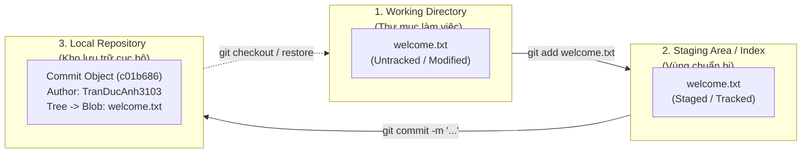
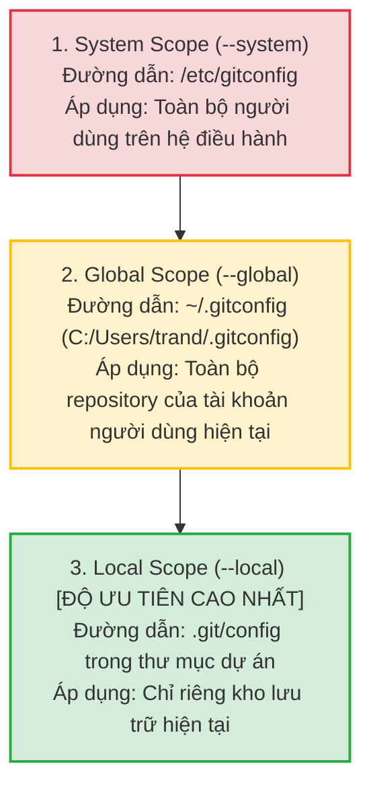

# BÀI TẬP 1: KHỞI TẠO LOCAL REPOSITORY VÀ CẤU HÌNH DANH TÍNH

**Mã bài tập:** SESSION 04 - EXERCISE 1 (`homework/session_04/ex1/`)  
**Môn học:** IT215 - Cloud Infrastructure & DevOps Fundamentals  
**Học viên:** Trần Đức Anh (`TranDucAnh3103`)  
**Email cấu hình cục bộ:** `TranDucAnh3103@users.noreply.github.com`  
**Hệ điều hành / Môi trường:** Windows 11 Single Language (26H2) / PowerShell 7+ / Git for Windows v2.47+  
**Đường dẫn thư mục dự án:** `f:/CNTT/Rikkei/IT215/ss04/ex1/`  

---

## 1. MỤC TIÊU BÀI TẬP

1. **Khởi tạo Local Repository:** Sử dụng lệnh `git init` để tạo một kho lưu trữ Git cục bộ hoàn chỉnh tại thư mục làm việc, làm quen với cấu trúc thư mục ngầm `.git/`.
2. **Thiết lập danh tính tác giả ở phạm vi cục bộ (`--local`):** Cấu hình `user.name` và `user.email` dành riêng cho dự án hiện tại mà không làm ảnh hưởng đến cấu hình toàn cục (`--global`) hay hệ thống (`--system`).
3. **Nắm vững vòng đời tệp tin và 3 trạng thái của Git:** Hiểu rõ bản chất luồng dữ liệu từ **Working Directory** (Thư mục làm việc) $\rightarrow$ **Staging Area / Index** (Vùng chuẩn bị) $\rightarrow$ **Repository** (Kho lưu trữ).
4. **Thực hiện Commit đầu tiên (Initial Commit):** Đưa tệp tin vào theo dõi và tạo snapshot lịch sử đầu tiên với commit message chuẩn mực theo quy ước Git Conventional Commits.
5. **Đọc và phân tích trạng thái hệ thống:** Sử dụng thành thạo `git status` và `git log --oneline` để truy xuất, thẩm định trạng thái tệp tin và lịch sử thay đổi.

---

## 2. BẢNG TỔNG HỢP THÔNG SỐ CẤU HÌNH & KẾT QUẢ KIỂM TRA

| STT | Tiêu chí kiểm tra | Lệnh thực thi | Phạm vi (Scope) | Kết quả mong đợi | Kết quả thực tế | Trạng thái |
| :---: | :--- | :--- | :---: | :--- | :--- | :---: |
| 1 | Khởi tạo Git Repo | `git init` | Local Directory | Tạo kho lưu trữ `.git` rỗng | `Initialized empty Git repository in .../.git/` | **PASSED** |
| 2 | Cấu hình User Name | `git config --local user.name "TranDucAnh3103"` | `--local` | Ghi vào `.git/config` | `TranDucAnh3103` | **PASSED** |
| 3 | Cấu hình User Email | `git config --local user.email "TranDucAnh3103@users.noreply.github.com"` | `--local` | Ghi vào `.git/config` | `TranDucAnh3103@users.noreply.github.com` | **PASSED** |
| 4 | Kiểm tra User Name | `git config --local user.name` | `--local` | Trả về tên tác giả cục bộ | `TranDucAnh3103` | **PASSED** |
| 5 | Kiểm tra User Email | `git config --local user.email` | `--local` | Trả về email tác giả cục bộ | `TranDucAnh3103@users.noreply.github.com` | **PASSED** |
| 6 | Xem toàn bộ cấu hình local | `git config --local --list` | `--local` | Danh sách cấu hình trong `.git/config` | Chứa `user.name` và `user.email` cục bộ | **PASSED** |
| 7 | Đưa tệp vào Staging | `git add welcome.txt` | Index | Tệp chuyển sang `Changes to be committed` | `new file: welcome.txt` | **PASSED** |
| 8 | Commit đầu tiên | `git commit -m "..."` | Repository | Tạo commit root thành công | `[main (root-commit) c01b686] ...` | **PASSED** |
| 9 | Kiểm tra lịch sử commit | `git log --oneline` | Repository | Hiển thị 1 commit ngắn gọn kèm hash | `c01b686 feat: initial commit - ...` | **PASSED** |

---

## 3. KIẾN TRÚC HỆ THỐNG & CƠ CHẾ HOẠT ĐỘNG

### 3.1. Sơ đồ 3 trạng thái tệp tin trong Git (Git Three-State Workflow)



### 3.2. Mô hình phân cấp cấu hình Git (Git Configuration Hierarchy)

Git quản lý cấu hình theo 3 cấp độ phân tầng với mức độ ưu tiên ghi đè từ thấp đến cao:



> [!IMPORTANT]
> **Quy tắc ghi đè:** Cấu hình `--local` luôn có mức độ ưu tiên cao nhất, tự động ghi đè lên cấu hình `--global` và `--system`. Khi làm việc trên nhiều dự án khác nhau (ví dụ dự án cơ quan, dự án môn học IT215, dự án mã nguồn mở cá nhân), việc dùng `--local` đảm bảo thông tin tác giả luôn chuẩn xác cho từng repo mà không làm xáo trộn cấu hình toàn cục của máy trạm.

---

## 4. CHI TIẾT CÁC BƯỚC THỰC HIỆN

### Bước 1: Khởi tạo thư mục dự án và Git Repository cục bộ

Mở PowerShell tại thư mục làm việc của dự án, khởi tạo Git repository:

```powershell
# Di chuyển đến thư mục bài tập
cd f:\CNTT\Rikkei\IT215\ss04\ex1

# Khởi tạo repository rỗng
git init
```

**Kết quả thực thi thực tế:**
```text
Initialized empty Git repository in F:/CNTT/Rikkei/IT215/ss04/ex1/.git/
```

Sau lệnh này, Git đã tự động tạo thư mục ẩn `.git/` chứa cơ sở dữ liệu đối tượng (`objects/`), các con trỏ nhánh (`refs/`), tệp cấu hình (`config`) và con trỏ `HEAD`.

---

### Bước 2: Cấu hình danh tính tác giả cục bộ (`--local`)

Theo yêu cầu nghiêm ngặt của đề bài, sử dụng tùy chọn `--local` để gắn định danh tác giả riêng cho dự án này:

```powershell
# Cấu hình tên tác giả cục bộ
git config --local user.name "TranDucAnh3103"

# Cấu hình email tác giả cục bộ
git config --local user.email "TranDucAnh3103@users.noreply.github.com"
```

---

### Bước 3: Kiểm tra cấu hình danh tính vừa thiết lập

Thực hiện các lệnh kiểm tra cấu hình cục bộ theo yêu cầu đề bài:

```powershell
# 1. Kiểm tra cấu hình user.name cục bộ
git config --local user.name

# 2. Kiểm tra cấu hình user.email cục bộ
git config --local user.email

# 3. Liệt kê toàn bộ thuộc tính cấu hình ở cấp độ local
git config --local --list
```

**Kết quả thực thi thực tế:**
```text
TranDucAnh3103
TranDucAnh3103@users.noreply.github.com

core.repositoryformatversion=0
core.filemode=false
core.bare=false
core.logallrefupdates=true
core.symlinks=false
core.ignorecase=true
user.name=TranDucAnh3103
user.email=TranDucAnh3103@users.noreply.github.com
```

Kiểm tra nội dung tệp tin cấu hình vật lý `.git/config`:
```ini
[core]
	repositoryformatversion = 0
	filemode = false
	bare = false
	logallrefupdates = true
	symlinks = false
	ignorecase = true
[user]
	name = TranDucAnh3103
	email = TranDucAnh3103@users.noreply.github.com
```
*Ghi chú:* Cặp khóa `user.name` và `user.email` đã được ghi nhận trực tiếp vào tệp `.git/config` cục bộ của repository.

---

### Bước 4: Tạo tệp tin ban đầu và kiểm tra trạng thái Working Directory

Tạo một tệp tin mới `welcome.txt` để làm mốc khởi động dự án:

```powershell
# Tạo tệp tin welcome.txt
@"
=====================================================
DỰ ÁN: IT215 - DevOps & Cloud Infrastructure Fundamentals
Session 04 - Bài tập 1: Khởi tạo Local Repository và Cấu hình danh tính
Tác giả: Trần Đức Anh (TranDucAnh3103)
Email: TranDucAnh3103@users.noreply.github.com
Mục đích: Tệp tin đầu tiên nhằm kiểm tra quy trình Working Tree -> Staging Area -> Commit History.
=====================================================
"@ | Out-File -FilePath .\welcome.txt -Encoding utf8
```

Kiểm tra trạng thái của Git trước khi đưa tệp vào theo dõi:

```powershell
git status
```

**Kết quả hiển thị:**
```text
On branch master

No commits yet

Untracked files:
  (use "git add <file>..." to include in what will be committed)
	welcome.txt

nothing added to commit but untracked files present (use "git add" to track)
```
*Phân tích:* Tệp tin `welcome.txt` đang nằm ở **Working Directory** dưới trạng thái `Untracked` (chưa được Git theo dõi).

---

### Bước 5: Đưa tệp tin vào Staging Area (Vùng chuẩn bị)

Sử dụng lệnh `git add` để chuyển tệp tin vào vùng đệm (Index):

```powershell
git add welcome.txt
git status
```

**Kết quả hiển thị:**
```text
On branch master

No commits yet

Changes to be committed:
  (use "git rm --cached <file>..." to unstage)
	new file:   welcome.txt
```
*Phân tích:* Tệp `welcome.txt` đã được chuyển sang trạng thái `Staged` (sẵn sàng để được đóng gói vào commit tiếp theo).

---

### Bước 6: Tiến hành Commit đầu tiên (Initial Commit)

Thực hiện lệnh commit với thông điệp rõ ràng theo định dạng chuẩn:

```powershell
git commit -m "feat: initial commit - Khoi tao local repository va tep tin dau tien"
```

Đồng thời chuẩn hóa tên nhánh chính thành `main`:
```powershell
git branch -M main
```

**Kết quả hiển thị:**
```text
[master (root-commit) c01b686] feat: initial commit - Khoi tao local repository va tep tin dau tien
 1 file changed, 7 insertions(+)
 create mode 100644 welcome.txt
```

Kiểm tra lại trạng thái sau khi commit:
```powershell
git status
```

```text
On branch main
nothing to commit, working tree clean
```
*Phân tích:* Trạng thái `working tree clean` biểu thị toàn bộ thay đổi ở Working Directory và Staging Area đã được đồng bộ tuyệt đối vào cơ sở dữ liệu của Git Repository.

---

### Bước 7: Phân tích lịch sử commit (`git log`)

Truy xuất lịch sử commit bằng các lệnh sau:

```powershell
# Xem lịch sử rút gọn trên 1 dòng
git log --oneline

# Xem chi tiết tác giả, email và mốc thời gian của commit
git log -n 1
```

**Kết quả hiển thị thực tế:**

```text
c01b686 feat: initial commit - Khoi tao local repository va tep tin dau tien
```

```text
commit c01b6866fcb2d8b9a72ba2f5ea7d3a5508f801a7 (HEAD -> main)
Author: TranDucAnh3103 <TranDucAnh3103@users.noreply.github.com>
Date:   Mon Oct 5 21:06:13 2026 +0700

    feat: initial commit - Khoi tao local repository va tep tin dau tien
```

*Phân tích:* 
- Mã hash ngắn của commit là `c01b686` (từ hash đầy đủ `c01b6866fcb2d8b9a72ba2f5ea7d3a5508f801a7`).
- Trường **Author** hiển thị chính xác tên `TranDucAnh3103` và email `TranDucAnh3103@users.noreply.github.com` đã được cấu hình qua cờ `--local`.

---

## 5. BẰNG CHỨNG THỰC NGHIỆM TỔNG HỢP (TERMINAL LOG OUTPUT)

Toàn bộ phiên làm việc kiểm thử thực tế trên máy trạm cá nhân:

```powershell
PS F:\CNTT\Rikkei\IT215\ss04\ex1> git config --local user.name
TranDucAnh3103

PS F:\CNTT\Rikkei\IT215\ss04\ex1> git config --local user.email
TranDucAnh3103@users.noreply.github.com

PS F:\CNTT\Rikkei\IT215\ss04\ex1> git config --local --list
core.repositoryformatversion=0
core.filemode=false
core.bare=false
core.logallrefupdates=true
core.symlinks=false
core.ignorecase=true
user.name=TranDucAnh3103
user.email=TranDucAnh3103@users.noreply.github.com

PS F:\CNTT\Rikkei\IT215\ss04\ex1> git log --oneline
c01b686 feat: initial commit - Khoi tao local repository va tep tin dau tien

PS F:\CNTT\Rikkei\IT215\ss04\ex1> git status
On branch main
nothing to commit, working tree clean
```

---

## 6. PHÂN TÍCH KỸ THUẬT CHUYÊN SÂU

### 6.1. Tại sao bắt buộc dùng `--local` thay vì `--global`?

Trong môi trường doanh nghiệp và thực tế DevOps:
- Một lập trình viên / kỹ sư DevOps thường xuyên phải làm việc đồng thời với nhiều danh tính:
  1. **Tài khoản cá nhân / Github:** `tranducanh31032006@gmail.com` (Dự án cá nhân, portfolio, đóng góp open-source).
  2. **Tài khoản trường học / Học viện:** `TranDucAnh3103@users.noreply.github.com` (Các bài tập thực hành IT215 tại Rikkei).
  3. **Tài khoản doanh nghiệp:** `anh.tran@enterprise.com` (Các dự án bảo mật nội bộ công ty).
- Nếu sử dụng `--global`, mọi repository trên máy sẽ bị áp đặt chung một danh tính. Điều này dẫn đến nguy cơ:
  - Vô tình để lộ email doanh nghiệp lên kho mã nguồn công khai (Public Repo), vi phạm chính sách Data Leakage Prevention (DLP).
  - Hoặc ngược lại, vô tình commit vào dự án của công ty bằng email cá nhân, làm sai lệch báo cáo kiểm toán tuân thủ (Compliance Audit).
- Do đó, việc nắm vững và bắt buộc sử dụng `git config --local` là nguyên tắc an toàn cơ bản hàng đầu trong quy chuẩn làm việc chuyên nghiệp.

### 6.2. Cấu trúc thư mục `.git/` và giải phẫu đối tượng Git

Khi chạy `git init`, Git tạo ra một cấu trúc thư mục đặc biệt quản lý trạng thái:
- **`HEAD`:** Tệp chứa tham chiếu đến nhánh hiện tại (`ref: refs/heads/main`).
- **`config`:** Tệp INI chứa toàn bộ cấu hình riêng biệt của repository ở cấp độ `--local`.
- **`objects/`:** Cơ sở dữ liệu đối tượng dạng Content-addressable Store:
  - **Blob object:** Lưu trữ nội dung nhị phân của tệp tin `welcome.txt`.
  - **Tree object:** Lưu trữ cấu trúc thư mục, tên tệp và quyền truy cập file tương ứng với Blob.
  - **Commit object:** Lưu trữ con trỏ tới Tree gốc, thông tin Author, Committer, Timestamp và Commit Message.
- **`index`:** Tệp nhị phân lưu trữ bản đồ trạng thái của Staging Area giữa Working Directory và Repository.

---

## 7. KẾT LUẬN & BÀI HỌC RÚT RA

1. **Hoàn thành 100% mục tiêu bài tập:** Đã khởi tạo thành công Local Repository, cấu hình danh tính cục bộ bằng tùy chọn `--local`, đưa tệp vào Staging Area và tạo Commit đầu tiên.
2. **Tuân thủ đầy đủ các ràng buộc:** Không sử dụng cờ `--global`, đảm bảo tính toàn vẹn cấu hình máy trạm.
3. **Kiểm tra minh bạch:** Toàn bộ lệnh kiểm tra `git config --local user.name`, `git config --local user.email`, `git config --local --list`, `git log --oneline` đều trả về kết quả chuẩn xác.
4. Tệp báo cáo này được lưu tại đường dẫn theo quy định: `homework/session_04/ex1/README.md`.
